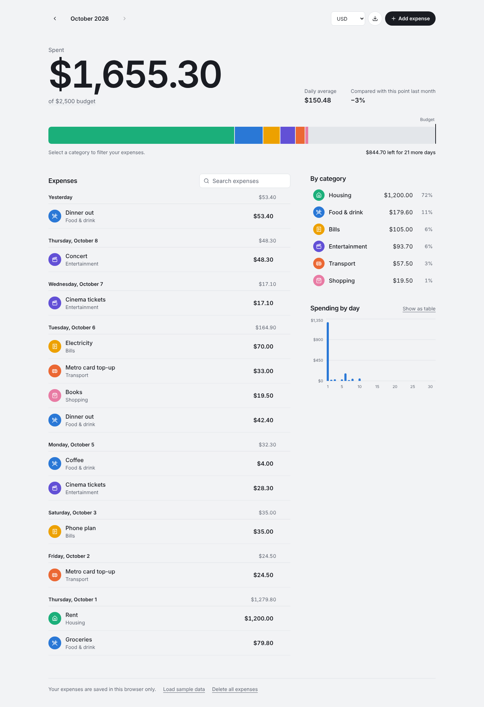

# Expense Tracker

A personal expense tracker built with React and TypeScript. Log what you spend, sort it into categories, set a monthly budget, and see where your money goes with a category breakdown and a day-by-day chart. Everything is saved in the browser, so there's no sign-up and no server.

**Live demo:** _add your Vercel or Netlify link here_



## Features

- Add, edit, and delete expenses with amount, description, category, and date
- Form validation with clear messages next to each field
- Undo after deleting an expense
- Monthly budget with a spending bar that shows each category's share and where the budget line falls
- Amount left or overspent, daily average, and a comparison with the same point last month
- Category breakdown with totals and percentages; select a category to filter the list and chart
- Day-by-day spending chart with tooltips, plus a table view for exact values
- Search expenses by description or category
- Browse previous months
- Export a month to CSV
- Currency choice (USD, EUR, GBP, EGP, SAR, AED, INR, JPY)
- Sample data on first visit so the dashboard isn't empty
- Data saved in local storage
- Automatic light and dark mode
- Accessible: keyboard-friendly dialog, labelled controls, visible focus, color-blind-safe category palette, and reduced-motion support

## Tech stack

- [React 19](https://react.dev/) with TypeScript
- [Vite](https://vite.dev/) for development and builds
- [Tailwind CSS v4](https://tailwindcss.com/)
- [Recharts](https://recharts.org/) for the daily spending chart, loaded on demand
- [Lucide](https://lucide.dev/) icons

## Getting started

You need [Node.js](https://nodejs.org/) 20.19 or newer.

```bash
git clone https://github.com/<your-username>/expense-tracker.git
cd expense-tracker
npm install
npm run dev
```

Then open http://localhost:5173.

| Command           | What it does                        |
| ----------------- | ----------------------------------- |
| `npm run dev`     | Starts the dev server               |
| `npm run build`   | Type-checks and builds to `dist/`   |
| `npm run preview` | Serves the production build locally |

## Project structure

```
src/
├── components/
│   ├── BudgetEditor.tsx       Inline budget editing
│   ├── CategoryBreakdown.tsx  Category totals that double as filters
│   ├── DailyChart.tsx         Spending-by-day chart and table view
│   ├── ExpenseForm.tsx        Add and edit dialog
│   ├── ExpenseList.tsx        Expenses grouped by day, with search
│   ├── MonthSwitcher.tsx
│   ├── SpendingSummary.tsx    Monthly total, budget bar, and stats
│   └── Toast.tsx              Confirmation messages with undo
├── hooks/
│   ├── useExpenses.ts         Add, update, delete, and restore expenses
│   └── useLocalStorage.ts
├── lib/
│   ├── categories.ts          Category names, colors, and icons
│   ├── csv.ts                 CSV export
│   ├── dates.ts               Date and month helpers
│   ├── id.ts
│   ├── money.ts               Currency formatting and amount parsing
│   └── sample.ts              Sample data generator
├── App.tsx
├── index.css
├── main.tsx
└── types.ts
```

Amounts are stored as whole numbers of cents to avoid floating-point rounding errors.

## Deploying

**Vercel:** [vercel.com/new](https://expense-tracker-one-bay-13.vercel.app/)). Vite is detected automatically.

**Netlify:**[ [Expense-Tracker-netlify] (https://mariamhus-expense-tracker.netlify.app/)
**note**: Netlify will work with vpn if you are connecting from Egypt.
